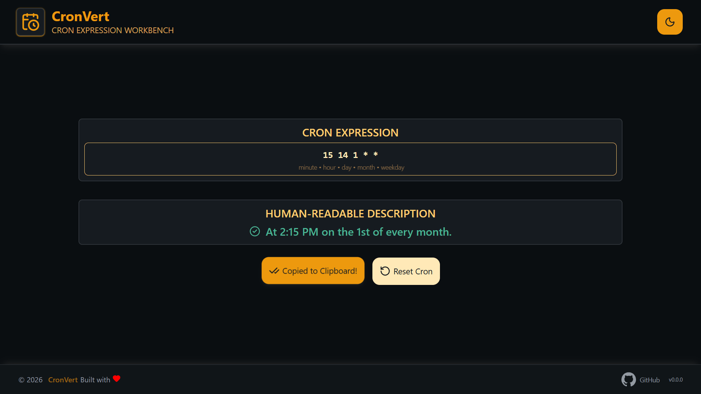
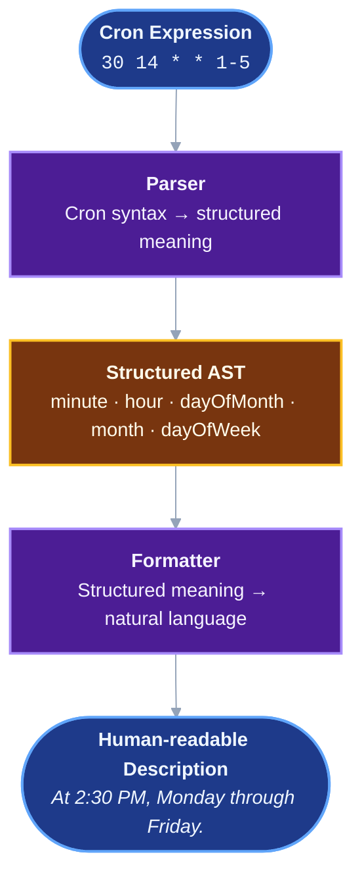

<div align="center">

# CronVert

**Understand cron expressions at a glance.**

Validate standard five-field cron expressions and translate them into clear, human-readable descriptions, entirely in your browser.


</div>



## Table of Contents

- [Overview](#overview)
- [Live Demo](#live-demo)
- [Features](#features)
- [Examples](#examples)
- [Supported Syntax](#supported-syntax)
- [Tech Stack](#tech-stack)
- [Getting Started](#getting-started)
- [Available Scripts](#available-scripts)
- [Project Architecture](#project-architecture)
- [Testing](#testing)
- [License](#license)

## Overview

Cron expressions are compact, but they are hard to read at a glance. Is `0 9 1-10/2 * *` what you think it is?

CronVert is a client-side React application that validates a cron expression and explains it in plain English as you type. Nothing is sent to a server, so your schedules stay on your machine.

## Live Demo

CronVert is deployed at **[CronVert](https://ozenfern.github.io/CronVert/)**. It runs entirely in your browser, so nothing you type leaves your device.

## Features

- **Live translation:** Descriptions update as you type.
- **Field-specific validation:** Clear error messages point to the field that is malformed.
- **One-click copying:** Copy the generated description to your clipboard.
- **Persistent preferences:** Your last cron input and theme choice are remembered between visits.
- **Fully client-side:** All parsing and formatting happens locally. No backend, no account.

## Examples

| Cron expression | Description                        |
| --------------- | ---------------------------------- |
| `*/15 * * * *`  | Every 15 minutes.                  |
| `30 14 * * 1-5` | At 2:30 PM, Monday through Friday. |

## Supported Syntax

CronVert supports the standard five-field cron format:

```text
┌───────────── minute        (0–59)
│ ┌─────────── hour          (0–23)
│ │ ┌───────── day of month  (1–31)
│ │ │ ┌─────── month         (1–12)
│ │ │ │ ┌───── day of week   (0–7)
│ │ │ │ │
* * * * *
```

### Expressions

| Syntax   | Meaning                       | Example          |
| -------- | ----------------------------- | ---------------- |
| `*`      | Every possible value          | `* * * * *`      |
| `5`      | A specific value              | `5 * * * *`      |
| `1-10`   | A range of values             | `0 9 1-10 * *`   |
| `1,5,10` | A list of values              | `0 9 1,5,10 * *` |
| `*/15`   | Every 15 values               | `*/15 * * * *`   |
| `1-10/2` | Every 2 values within a range | `0 9 1-10/2 * *` |

### Field ranges

| Field        | Allowed values |
| ------------ | -------------- |
| Minute       | `0–59`         |
| Hour         | `0–23`         |
| Day of month | `1–31`         |
| Month        | `1–12`         |
| Day of week  | `0–7`          |

> [!NOTE]
> Both `0` and `7` represent Sunday in the day-of-week field.

### Not supported

- Named values such as `JAN` or `MON`
- Seconds fields (six-field expressions)
- Special characters such as `?`, `L`, `W`, and `#`
- Step expressions without an explicit range or wildcard, such as `5/15`

## Tech Stack

| Technology                                               | Purpose                          |
| -------------------------------------------------------- | -------------------------------- |
| [React 19](https://react.dev/)                           | UI development                   |
| [React Compiler](https://react.dev/learn/react-compiler) | Automatic component optimization |
| [Vite 8](https://vite.dev/)                              | Dev server and production builds |
| [Tailwind CSS 4](https://tailwindcss.com/)               | Styling                          |
| [Lucide React](https://lucide.dev/)                      | Icons                            |
| [Vitest](https://vitest.dev/)                            | Unit testing                     |
| [Oxlint](https://oxc.rs/)                                | Linting                          |
| [Oxfmt](https://oxc.rs/)                                 | Code formatting                  |
| [React Doctor](https://react.doctor/)                    | React diagnostics                |

## Getting Started

### Prerequisites

- [Node.js 24+](https://nodejs.org/)
- npm

### Installation

```bash
# 1. Clone the repository
git clone https://github.com/OzenFern/CronVert

# 2. Enter the project directory
cd CronVert

# 3. Install dependencies
npm ci

# 4. Start the development server
npm run dev
```

Vite prints a local URL you can open in your browser.

## Available Scripts

| Command                                        | Description                             |
| ---------------------------------------------- | --------------------------------------- |
| `npm run dev`                                  | Start the development server            |
| `npm run build`                                | Build for production                    |
| `npm run preview`                              | Preview the production build locally    |
| `npm run lint`                                 | Run Oxlint                              |
| `npm run lint:fix`                             | Automatically fix supported lint issues |
| `npm run fmt`                                  | Format the code with Oxfmt              |
| `npm run fmt:check`                            | Check code formatting                   |
| `npm test -- --run`                            | Run the test suite once                 |
| `npm test -- --run src/lib/parseField.test.js` | Run tests for a single file             |
| `npm run doctor`                               | Run React Doctor diagnostics            |

## Project Architecture

CronVert separates **understanding** a cron expression from **describing** it. The parser turns cron syntax into a structured object (an AST), and the formatter turns that object into text. The formatter never sees `*`, `-`, `,`, or `/`, and the parser never writes English.

This keeps the core logic independent of the React UI and easy to test.

### Conversion flow



### Core modules

| Module          | Responsibility                                              |
| --------------- | ----------------------------------------------------------- |
| `parseField.js` | Parses and validates a single cron field                    |
| `parseCron.js`  | Validates the full five-field expression and builds the AST |
| `formatCron.js` | Converts the AST into a human-readable description          |
| `cronToText.js` | Main entry point that connects parsing and formatting       |

### The AST at a glance

Each field is parsed into an object with a `type` of `any`, `exact`, `range`, `list`, or `step`. For example, `30 14 * * 1-5` becomes:

```js
{
  minute:     { type: "exact", value: 30 },
  hour:       { type: "exact", value: 14 },
  dayOfMonth: { type: "any" },
  month:      { type: "any" },
  dayOfWeek:  { type: "range", start: 1, end: 5 },
}
```

The full specification lives in [`docs/cron-ast.md`](docs/cron-ast.md).

## Testing

Parsing and conversion logic is tested independently of the UI with Vitest. Tests cover supported syntax, field validation, malformed expressions, and edge cases.

```bash
npm test -- --run
```

## License

Released under the [MIT License](LICENSE).
